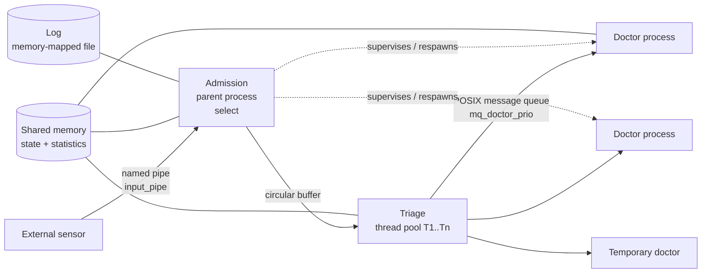

# Emergency Room Management System (C / POSIX)

> 🇵🇹 [Versão em português](README.pt.md)

A concurrent simulation of a hospital emergency department, written in **C** on top of **POSIX** primitives. It combines multiple processes, threads and inter-process communication mechanisms to admit, triage and treat patients, while staying resilient to failures.

*Over 50 hours of development.*

## ✨ Highlights
- Multi-process **and** multi-threaded design (`fork()` + thread pool)
- IPC: named pipes, shared memory, POSIX message queues, memory-mapped files
- Synchronization with POSIX semaphores and non-blocking `sem_trywait`
- Fault isolation, process supervision, dynamic scaling under load
- Graceful shutdown with full resource cleanup and no zombie processes

## 🏗️ Architecture



### 1. Core architecture
- **Admission (parent process):** receives patient data from an external sensor through a named pipe (`input_pipe`) and multiplexes events with `select()`.
- **Triage:** a dynamic thread pool (T1, T2, …) shares a **circular buffer** that serves as the admission queue.
- **Medical care:** each doctor is an independent process created with `fork()`, isolating faults so local errors (e.g. segmentation faults) never crash the main process.

### 2. IPC and concurrency control
- **Shared state:** global state and statistics live in **shared memory**, protected by binary **POSIX semaphores** to prevent race conditions.
- **Triage → doctor routing:** a **POSIX message queue** (`mq_doctor_prio`) delivers patients to doctors, using the OS's native message priorities so urgent patients are seen first.
- **Queue entry:** insertion into the circular buffer uses non-blocking `sem_trywait` with two control semaphores, so the system never blocks when the queue is full.

### 3. Resilience and fault tolerance
- **Event logging:** events are written to a **memory-mapped file**; the kernel handles syncing to disk.
- **Process supervision:** the parent detects dead doctor processes, rotates shifts automatically and spawns **temporary reinforcements** during peak load.
- **Graceful shutdown:** `SIGINT` triggers a shutdown that waits for ongoing consultations, releases every resource and prevents zombie processes.

## 🔨 Build & Run
> ✏️ **Diogo: preenche com os teus comandos reais e apaga esta linha.**

```bash
# Build
gcc -Wall -Wextra -pthread -o urgencias *.c -lrt   # ou: make

# Run
./urgencias [ficheiro_config]

# Send patients (another terminal)
echo "..." > input_pipe
```

Requires Linux (POSIX shared memory, message queues and semaphores).

## 👤 Author
**Diogo Silva**, Computer Engineering @ University of Coimbra
